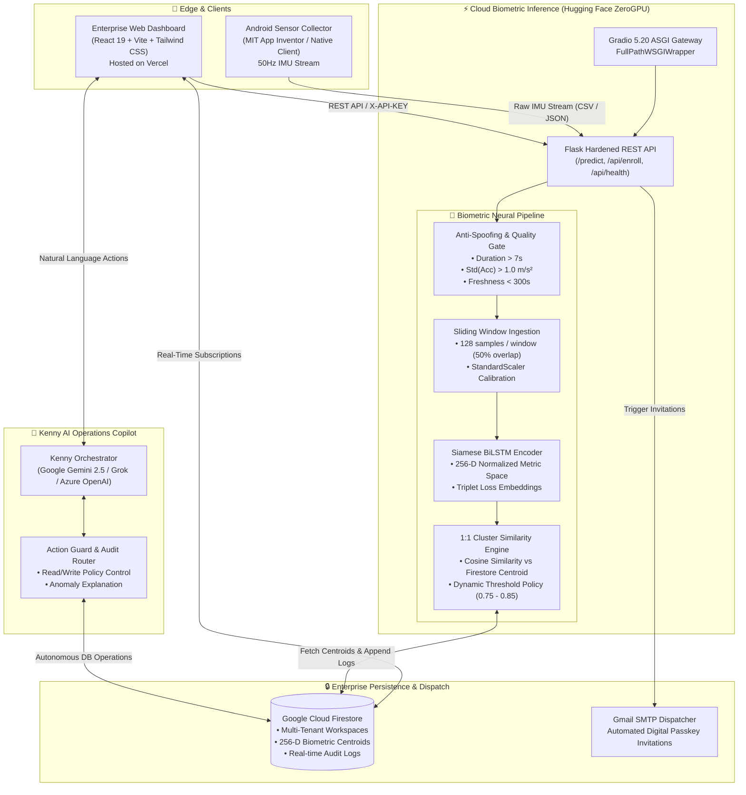
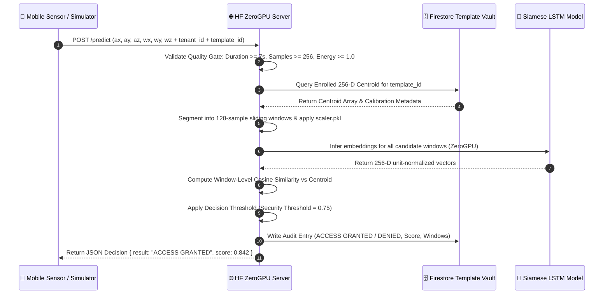

# 🛡️ GaitAuth: Enterprise Continuous Biometric Authentication Platform

[](https://vercel.com)
[](https://huggingface.co/spaces/kartik33541/gaitauth-backend)
[](https://react.dev)
[](https://tensorflow.org)
[](https://firebase.google.com)
[](https://tailwindcss.com)

> **Zero-Friction, Contactless Identity Verification Powered by Deep Metric Learning & Behavioral Biometrics.**  
> GaitAuth verifies user identities passively through smartphone motion dynamics (accelerometer and gyroscope data). Featuring a 256-dimensional Siamese Recurrent Neural Network, real-time Cloud Firestore vaulting, an automated onboarding pipeline, and Kenny—an enterprise multi-model AI operations copilot.

---

## 🌐 Live System Deployments

- **Biometric Inference Cloud Gateway:** [`https://kartik33541-gaitauth-backend.hf.space`](https://kartik33541-gaitauth-backend.hf.space)
- **Hugging Face ZeroGPU Console:** [`https://huggingface.co/spaces/kartik33541/gaitauth-backend`](https://huggingface.co/spaces/kartik33541/gaitauth-backend)
- **Official Repository:** [`https://github.com/kartik33541/gait-authentication-system`](https://github.com/kartik33541/gait-authentication-system)

---

## 🏛️ System Architecture



---

## 🔬 Biometric Pipeline & Metric Learning



### Deep Metric Learning Principles
1. **Feature Extraction:** 6-axis raw kinematic data captures gait cadence, step amplitude, ground impact shock, and rotational pelvic torsion.
2. **Quality & Anti-Spoofing Filter:** Rejects stationary phones, table drops, and low-energy movements via dynamic acceleration variance:
   $$\sigma(\sqrt{a_x^2 + a_y^2 + a_z^2}) \ge 1.0 \text{ m/s}^2$$
3. **Embeddings:** Evaluated using a Siamese Bidirectional LSTM trained with **Triplet Loss**, projecting walking dynamics into a hypersphere where intraclass variance is minimized and interclass separation is maximized.

---

## ✨ Enterprise Features

### 1. 🏢 Multi-Tenant Management Portal
- **Workspace Architecture:** Complete logical isolation by `tenant_id` allowing multiple corporate entities to manage their own employee rosters, policy perimeters, and biometric thresholds independently.
- **Enterprise Onboarding Wizard:** Seamless 4-stage pipeline guiding administrators through company creation, template definition, multi-sample training, and cluster calibration.

### 2. 🤖 Kenny AI: Enterprise Operations Copilot
- **Multi-Model Intelligence:** Powered natively by Google Gemini, with automatic fallback support to xAI Grok and Azure OpenAI.
- **Natural Language Navigation:** Understands conversational commands like *"Navigate to active workspace"*, *"Show me all access denials from the last 24 hours"*, or *"What is our current biometric threshold?"*.
- **Autonomous Action Guard:** Enforces strict confirmation barriers before executing state-changing administrative operations.

### 3. 📊 Real-Time Telemetry & Simulation Suite
- **Live Device Stream:** Dynamic telemetry feed displaying live motion signals, current window similarity scores, and immediate visual verification results.
- **Integrated Test Walk Simulator:** Built-in benchmarking suite that allows administrators to inject authentic enrolled walks or un-enrolled impostor walks to evaluate false acceptance (FAR) and false rejection (FRR) rates in real time.

### 4. ✉️ Automated Passkey Dispatch
- Newly enrolled employees automatically receive a cryptographic biometric passkey and onboarding link delivered via a custom HTML email template generated by the backend SMTP service.

---

## 📂 Repository Organization

```plaintext
Gait_Auth/
├── frontend/                     # React 19 + Vite Enterprise Web App
│   ├── public/                   # Static assets, branding, and Android APK downloads
│   ├── src/
│   │   ├── components/           # Modular UI: Dashboard, Kenny AI, Layout, Workspace
│   │   ├── pages/                # Landing, Auth, Dashboard, KennySpace, Onboarding
│   │   ├── services/             # Gemini AI, Kenny Action Guard, RAG service
│   │   └── lib/biometricApi.js   # Centralized HTTP gateway to ZeroGPU backend
│   ├── .env.example              # Frontend environment template
│   ├── vercel.json               # Vercel Single-Page Application rewrites
│   ├── vite.config.js            # Vite build configuration
│   └── package.json              # React 19 dependencies & scripts
│
├── production/                   # Hardened Production Biometric Server
│   ├── app/
│   │   ├── flask_server.py       # REST API: /predict, /api/enroll, /api/health
│   │   ├── firestore_service.py  # Google Cloud Firestore multi-tenant driver
│   │   └── email_service.py      # Gmail SMTP automated invitation dispatcher
│   ├── LSTM_engine/
│   │   ├── siamese_lstm.weights.h5 # Pretrained 256-D Siamese weights
│   │   ├── infer_realtime_live.py  # ZeroGPU accelerated inference engine
│   │   └── dataset_loader.py       # Sensor windowing & pre-processing
│   ├── scaler.pkl                # Calibrated global StandardScaler
│   └── README.md                 # Production architecture documentation
│
├── research/                     # Machine Learning Research & Benchmarks
│   ├── notebooks/                # Jupyter exploration on UCI HAR & Physics Toolbox
│   └── RealWorld1/               # Empirical baseline dataset
│
├── docs/                         # Technical Architecture & Operations Manuals
│   ├── GaitAuth_Product_Manual.md
│   ├── Readme_dashboard_features.md
│   ├── Documentation.md
│   └── llm_usage.md
│
├── app.py                        # Hugging Face ZeroGPU ASGI entrypoint (Gradio + WSGI)
├── wsgi.py                       # Production WSGI application wrapper
├── Dockerfile                    # Containerization configuration
├── requirements.txt              # Production Python dependencies
└── .gitignore                    # Master exclusion list (secrets, legacy, builds)
```

---

## 🚀 Quickstart Guide

### Option 1: Frontend Development (React 19 + Vite)

```bash
# 1. Navigate to the frontend directory
cd frontend

# 2. Install dependencies
npm install

# 3. Create environment configuration
cp .env.example .env

# 4. Start local development server
npm run dev
```
> The dashboard will start at `http://localhost:5173`, automatically bridged to the live cloud backend.

### Option 2: Deploy Frontend to Vercel

1. Import the repository `kartik33541/gait-authentication-system` into [Vercel](https://vercel.com).
2. Set **Root Directory** to `frontend`.
3. In **Project Settings → Environment Variables**, configure:
   - `VITE_ML_API_URL` = `https://kartik33541-gaitauth-backend.hf.space`
   - `VITE_ML_GATEWAY_KEY` = `GAIT_SECURE_2026`
   - `VITE_GEMINI_API_KEY` = `your_gemini_api_key`
4. Click **Deploy**. Vercel will build the SPA with automatic routing rewrites (`vercel.json`).

### Option 3: Backend Local Execution (Python 3.11 / 3.12)

```bash
# 1. Create and activate a virtual environment
python -m venv venv
# On Windows:
venv\Scripts\activate
# On Linux/macOS:
source venv/bin/activate

# 2. Install dependencies
pip install -r requirements.txt

# 3. Configure environment
cp .env.example .env

# 4. Run the production WSGI server
python wsgi.py
```
> The server initializes at `http://127.0.0.1:8000` with the Siamese LSTM engine and Cloud Firestore vault loaded.

---

## 🔌 API Gateway Reference

All endpoints accept standard JSON payloads and require the `X-API-KEY` security header:

| Method | Endpoint | Description | Key Headers |
|---|---|---|---|
| `GET` | `/api/health` | Service latency, ZeroGPU status, and Firestore health | None |
| `POST` | `/predict` | 1:1 Siamese LSTM motion matching against stored centroid | `X-API-KEY`, `X-TENANT-ID` |
| `POST` | `/api/enroll` | Window feature extraction & 256-D centroid generation | `X-API-KEY`, `X-TENANT-ID` |
| `POST` | `/api/send-invite` | Dispatches automated HTML passkey invitation email | `X-API-KEY`, `X-TENANT-ID` |

---

## 🔒 Security & Privacy by Design

- **Non-Invertible Embeddings:** Only 256-dimensional mathematical centroids are stored in Cloud Firestore. Raw accelerometer and gyroscope sensor streams are discarded immediately after feature extraction and cannot be reverse-engineered into physical body measurements.
- **Tenant Isolation:** Multi-tenant Firestore collections ensure zero cross-talk between corporate workspaces.
- **Anti-Spoofing Kinetic Checks:** Enforces physical energy thresholds and temporal variance constraints to mitigate replay attacks and synthesized accelerometer data.

---

## 📄 License & Attribution

This project is released under the **MIT License**.  
Developed and maintained by **Kartik** ([@kartik33541](https://github.com/kartik33541)).
