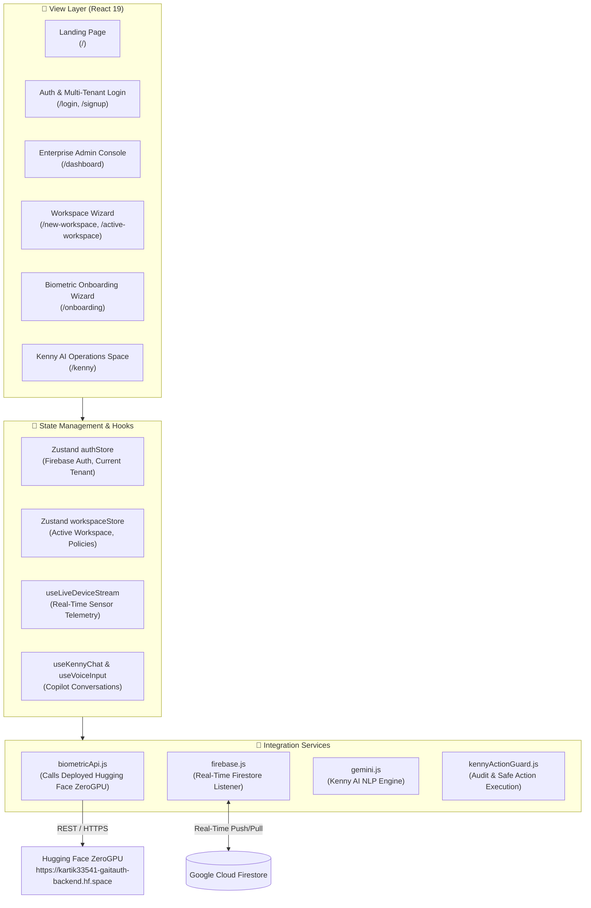

# 🖥️ GaitAuth Enterprise Web Dashboard

[](https://react.dev)
[](https://vitejs.dev)
[](https://tailwindcss.com)
[](https://vercel.com)

> The modern administrative command center for the GaitAuth Continuous Biometric Authentication Platform. Built with React 19, Tailwind CSS, Framer Motion, and Google Cloud Firestore.

---

## 🏗️ Frontend Architecture



---

## 🌟 Key Features

### 1. 🏢 Multi-Tenant Workspace Management
- **Company Context Isolation:** Administrators switch between isolated corporate workspaces (`tenant_id`), each with its own employee roster, biometric sensitivity threshold, and access logs.
- **Security Perimeter Policies:** Custom policies with dynamic match thresholds (0.75 - 0.85), auto-lockout timers, and real-time perimeter alert banners.

### 2. 🧪 Integrated Test Walk Simulator
- Built-in biometric simulator (`TestWalkModal.jsx`) that lets security administrators replay authentic enrolled employee sensor traces or test un-enrolled intruder walks against the live Siamese LSTM neural engine with instant score telemetry.

### 3. 🤖 Kenny AI: Autonomous Operations Copilot
- **Voice & Text Interface:** Supports natural voice input and typed instructions.
- **Context-Aware Navigation:** Ask Kenny to *"Show me suspicious attempts"* or *"Take me to employee onboarding"*, and the copilot autonomously directs you to the exact page.
- **Database Querying & Insights:** Explains biometric anomalies, failure reasons, and system metrics in plain English.

### 4. 📈 Real-Time Biometric Stream & Analytics
- Live visual telemetry feeds displaying continuous motion variance ($a_x, a_y, a_z, \omega_x, \omega_y, \omega_z$), match scores, and door status indicators via Recharts.

---

## 📋 Environment Configuration

Create a `.env` file inside the `frontend/` directory (or use `.env.example` as a template):

```bash
# Deployed Hugging Face ZeroGPU Biometric Backend
VITE_ML_API_URL=https://kartik33541-gaitauth-backend.hf.space
VITE_ML_GATEWAY_KEY=GAIT_SECURE_2026

# Kenny AI Assistant (Google Gemini)
VITE_GEMINI_API_KEY=your_gemini_api_key_here

# Optional: Kenny AI Assistant (xAI Grok)
VITE_GROK_API_KEY=your_xai_grok_api_key_here

# Optional: Azure OpenAI Fallback Configuration
VITE_AZURE_OPENAI_ENDPOINT=https://your-resource.openai.azure.com
VITE_AZURE_OPENAI_API_KEY=your_azure_openai_api_key_here
VITE_AZURE_OPENAI_API_VERSION=2025-03-01-preview
VITE_AZURE_OPENAI_DEPLOYMENT=gpt-5.4-nano
```

---

## 🛠️ Local Development

```bash
# 1. Install dependencies
npm install

# 2. Run local development server
npm run dev

# 3. Build for production
npm run build

# 4. Preview production build
npm run preview
```

---

## 🚀 Vercel Deployment Guide

This project is pre-configured for zero-friction deployment to Vercel:

1. **Connect Repository:** Import the repository into your Vercel account.
2. **Set Root Directory:** In the project setup modal, click **Edit** next to **Root Directory** and select **`frontend`**.
3. **Framework Preset:** Vercel will automatically select **Vite**.
4. **Environment Variables:** In **Project Settings → Environment Variables**, add:
   - `VITE_ML_API_URL` → `https://kartik33541-gaitauth-backend.hf.space`
   - `VITE_ML_GATEWAY_KEY` → `GAIT_SECURE_2026`
   - `VITE_GEMINI_API_KEY` → *(Your Google Gemini API Key)*
5. **SPA Routing:** Handled automatically by [`vercel.json`](./vercel.json) via route rewrites:
   ```json
   {
     "rewrites": [
       { "source": "/(.*)", "destination": "/index.html" }
     ]
   }
   ```
6. **Click Deploy:** Your enterprise biometric dashboard is live with continuous deployment on git push!
